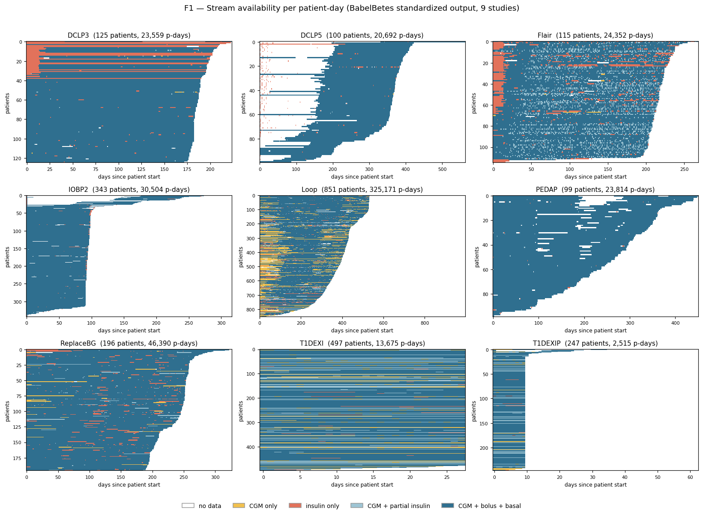

# Babelbetes Output Verification

*Verification plan for the Babelbetes standardized output.*
*Draft for review, September 2026.*

Exhaustive metric computation over all patients in all studies, followed by targeted inspection of
the extremes. This document defines the metrics, how outliers are identified, and how findings are
classified and resolved.

---

## 1. Scope and verification target

Babelbetes brings datasets from several high-quality clinical trials into a common schema. The source
data is already of high quality and has been used in regulatory submissions; what has to be
established is that the **reconstruction of the original event series is accurate**. That is not
trivial: formats and sources vary, much of the encoding is device-specific, and the interpretation
leaves considerable room for human error.

Formal validation as described in V&V 40 for CM&S is specific to a context of use, and risk
management depends on the context of use in mind. Babelbetes provides a standardized view of the data
through transformation and will be used across many different contexts of use. Formal validation and
risk management without a specific context of use therefore do not apply.

What this document describes is consequently **verification, not validation**. Validation asks
whether the output is fit for an intended use; with no context of use there is none to ask about. The
question that remains — does the output state what actually happened? — is a verification question.

*A note on vocabulary.* Kahn et al. use the two terms on a different axis, where verification means
expectations derived internally and validation means comparison against an external gold standard. On
that axis this work is also predominantly verification; the one exception is outcome matching against
published study results.

We instead define the verification target as **reconstructing reality as closely as possible**,
established in four steps:

1. **Exhaustive investigation** — per-dataset notebooks documenting every decision and finding.
2. **Code verification** — formal schema validation and unit tests for the transformation logic.
3. **Face validation** — plotting the data and inspecting it for expected trends and distributions.
4. **Output screening and sample inspection** — exhaustive metric computation over all patients,
   followed by targeted inspection of the extremes. This document.

Steps 1–3 are already in place and documented in the repository — the per-dataset notebooks, the
schema validation and unit tests, and the plots produced while building each parser. This document
covers step 4.

> Physiologically impossible value and structurally suspicious data in the Babelbetes output 
> were systematically searched and inspected and if deemed to be erroneous either fixed or excluded.


---

## 2. Process

1. **Compute** — every metric, for every patient, in every study.
2. **Identify** — hard violations and soft outliers, per study.
3. **Select** — the cases to inspect.
4. **Inspect and record** — each case receives a source-fidelity judgement, an explanation and a
   decision.
5. **Resolve and repeat** — corrections go back into the parsers; the screen is re-run and compared
   against the previous run.

Metrics are computed once and stored, so every figure and table regenerates after a correction. The
comparison against the previous run is what shows that a fix moved what it was supposed to move, and
nothing else.

---

## 3. Metrics

The metric set is motivated by the failure modes encountered while building the parsers. Those
specific defects are documented and largely fixed; the metrics are not there to re-find them, but to
detect the **effects that similar problems would produce**. Most of the complexity sits in insulin and
in time reconstruction, which is why most metrics are targeted at these.

All metrics are computed directly from the standardized event streams. Every metric is computed for
all patients in all studies. The screen then inspects the **extremes**; how outliers are identified
and how many of them are selected for inspection is defined in the next section.

| Observable effect | Example failure mode |
|---|---|
| **Too much insulin** | temporal duplicates · priming doses · MDI injections · temp-basal percentages not applied or applied twice · basal reported during AutoMode micro-bolus periods · missing suspends · extended boluses reported twice |
| **Too little insulin** | basal stream never imported or stopping mid-record · data gaps · a single rate carried across a long interval · terminal records of undefined duration |
| **Incomplete or misaligned coverage** | streams imported from different sources or periods · data beyond the study duration imported for individual data types · carb records split across files |
| **Signal shifts, unexpected temporal patterns** | local time reconstructed from incomplete timezone information · streams spliced from several sources · sampling cadence departing from the device interval |

### Two challenge sets

Findings are collected into two sets with different pass criteria. The distinction is not one of
severity, but of whether a reference value exists.

The **hard set** collects observations that are physiologically or technically impossible, or very
nearly so: values outside the device reporting range, magic numbers used to encode sensor failures,
doses no pump can deliver, exact duplicates, a day with no insulin at all. Nothing here needs
calibration — a reference value exists and the observation violates it. The pass criterion is that
the set is empty: every entry is either corrected, or explicitly approved with a documented
mechanism.

The **soft set** collects outliers in trends and distributions — patients whose totals, variability,
coverage or composition sit far from the rest of their study. These may be extreme but genuine
therapy, or they may point to a data error; the metric itself cannot tell. There is no reference
value, only a distribution, which differs by study, device and population, so detection is relative
to the patient's own study. The pass criterion is not emptiness — there is always a most extreme
patient — but that every entry has been inspected and explained.

### A · Schema conformance

Babelbetes validates the output schema as part of the pipeline. These metrics check once more, on the
written output, whether anything was missed. Point level, all hard; the expected value of every one
of them is zero.

| Metric | Definition | Unit | Examples |
|---|---|---|---|
| CGM bounds | share of samples below the sensor minimum, above the sensor maximum, and not integer-valued | % of samples (3 values) | magic numbers encoding sensor failures — e.g. 39 and 401 where the reporting range is 40–400 |
| Bolus bounds | share of doses below 0 and above the device maximum | % of boluses (2 values) | doses beyond what the pump can deliver — e.g. a 46 U bolus on a pump capped at 30 U |
| Basal rate bounds | share of events below 0 and above the device maximum | % of events (2 values) | unit and encoding errors — e.g. a rate of 11 160 U/h |
| Carb bounds | share of entries below 0 and above the physiologic maximum | % of entries (2 values) | implausible entries — e.g. a negative amount, or a single 3 000 g meal |
| Overlapping boluses | share of boluses whose delivery interval extends past the start of the next | % of boluses | the same extended bolus written twice, once at start and once at completion |

### B · Data coverage

Defined over the **mandatory streams** — CGM, bolus and basal. Carbs are reported as coverage only,
since they exist in two datasets. For a stream *s*, let *first(s)* and *last(s)* be the first and last
day carrying data.

**Union span\*** — the full extent of the patient's record:

```
union_span = max( last(cgm), last(bolus), last(basal) )
           - min( first(cgm), first(bolus), first(basal) ) + 1
```

**Core span\*** — the window bounded by all three streams, clamped at zero:

```
core_span  = max( 0,  min( last(cgm),  last(bolus),  last(basal)  )
                    - max( first(cgm), first(bolus), first(basal) ) + 1 )
```

| Metric | Definition | Unit | Examples |
|---|---|---|---|
| Span efficiency | core_span\* ÷ union_span\* | ratio, 0–1 | streams that do not start and stop together — e.g. pump history imported for months before the CGM record begins |
| Core completeness | days inside core_span\* carrying all mandatory streams ÷ core_span\* | ratio, 0–1 | holes inside the covered window — e.g. a week in which only CGM was recorded |
| Core coverage per stream | days inside core_span\* carrying that stream ÷ core_span\* | ratio, 0–1 (3 values, 4 where carbs exist) | a stream that is thin throughout — e.g. carb records split across two files with a gap between them |
| Gap size | geometric mean and geometric SD of intervals between consecutive events of a stream, inside core_span\* | hours; SD dimensionless (2 values per stream) | long intervals between events of one type — e.g. a basal rate carried unchanged for three weeks |

**Span efficiency and core completeness are independent by construction**: the first describes the
edges of the record, the second its interior. Read together they separate two different problems. A
patient at 0.98 / 0.55 has clean edges and a shredded interior — an import problem. One at
0.40 / 1.00 has intact data with an overhanging import, and is a candidate for clipping rather than
correction.

### C · Plausibility

Daily totals are the substrate; every metric reports one value per patient.

| Metric | Definition | Unit | Type | Examples |
|---|---|---|---|---|
| Zero-dose days | days with TDD < 1 U | count, and % of core days | hard | basal never imported, or a stream stopping mid-record |
| TDD μ\* | robust geometric mean of daily totals | U/day | soft | a record shifted in level — e.g. a standard basal rate profile counted on top of Loop micro-bolusing, leaving a patient with an extremely high total for their study; or temp-basal percentages never applied |
| TDD σ\* | robust geometric SD of daily totals | ratio, ≥ 1 | soft | widespread instability — e.g. a therapy change mid-study, or systematically incomplete days |
| TDD max multiple | highest daily total ÷ μ\*, with the date | ratio, ≥ 1 | soft | a single extreme day — e.g. a priming dose recorded as a 40 U bolus |
| TDD min multiple | μ\* ÷ lowest daily total over days ≥ 1 U, with the date | ratio, ≥ 1 | soft | partial under-delivery — e.g. a day on which only half the basal was imported |
| Basal share | basal dose ÷ TDD | ratio, 0–1 | soft | basal rates missing or incorrectly transformed — e.g. incorrectly derived from MDI injections, or double-counted during AutoMode. A share near zero is correct for MDI patients |
| Duplicate count | near-identical doses ≥ 0.5 U within one minute | count, and % of boluses | soft | the same bolus recorded twice, with or without a rounding difference |
| CGM rate of change | largest absolute change per minute between consecutive samples | mg/dL per minute | soft | discontinuities where segments with different time offsets were spliced — e.g. glucose jumping 120 mg/dL between two five-minute samples |

μ\* and σ\* are estimated robustly, from the median and MAD of the log daily totals. This keeps them
insensitive to single extreme days, so that σ\* responds to *widespread* deviation while the max and
min multiples respond to *single* events — the two therefore carry different information.

The min multiple is computed only over days that pass the zero-dose check, so that it measures
partial under-delivery rather than restating a hard metric.

---

## 4. Outlier identification

For sample inspection we focus on outliers. Outliers are defined relative to the study population,
because expected values depend on the study's device, protocol and population — frequent basal rate
change intervals are normal in one study and alarming in another. Sampling each study separately also
keeps the inspection from collapsing onto the single most extreme study.

Hard metrics need no selection: a reference value exists, and any violation enters the hard set. Soft
metrics come in two kinds:

| Metrics | Reference | An outlier is |
|---|---|---|
| Span efficiency, core completeness, duplicate count, zero-dose days | a constant — 1 or 0 | a large distance from it |
| TDD μ\*, TDD σ\*, min and max multiple, basal share, gap sizes, CGM rate of change | the study population | a large deviation from its center |

Population parameters are estimated **robustly**, from the median and MAD. Classical estimates are
pulled toward the extremes they are meant to find, so correcting those patients shifts the center and
declares a new set of ordinary patients extreme — a cascade that never ends.

Two separate decisions then follow. An **outlier** is a surprising finding, for example more than
three robust standard deviations from the population center; the size of that set is reported, not
capped. **Inspection** covers *n* of them, which reflects available time rather than the data. Both
are reported together: *41 outliers, 5 inspected*.

A **case** is a patient, not a metric hit — one cause typically trips several metrics at once, and
they are inspected together. Counting metric hits would give studies × metrics × *n* cases; counting
patients gives studies × *n*. Per study we therefore take *n* patients, plus — for any metric whose
outliers are not already represented among those *n* — its most extreme patient, so that no metric
goes unexamined. Where a metric carries a date (TDD max and min multiple), inspection starts at that
day.

> **TBD** — the deviation that defines an outlier (start: 3 robust SD), *n* (start: 5 per study), and
> whether the *n* are the most extreme or a random draw from the set.

---

## 5. What happens to a finding

Every inspected case is recorded with three independent pieces of information.

**1 — Is it faithful to the source?**
Whether the output correctly reflects the source record under the documented reconstruction rules.
*Yes · No · Unclear.* A *no* is a Babelbetes defect. *Unclear* covers a source that is ambiguous,
where the reconstruction rests on a documented assumption.

**2 — Is it explainable?**
The cause in plain words: physiology (pregnancy, illness, regimen change), priming dose, MDI therapy,
duplicated export, missing suspend, temp-basal conversion, import gap — or *none found*.

**3 — Is it an error, and does it need a change?**
An error means the output states something that did not happen. The decision follows:

- **Accept** — kept and documented
- **Correct** — fixed in the parser
- **Exclude** — removed from the output

Every decision carries a written rationale.

The three are independent, and that is the point: a value can be faithful to the source and still not
represent what was delivered.

| Faithful | Explanation | Error | Typical decision |
|---|---|---|---|
| yes | physiology | no | accept |
| yes | MDI therapy | no | accept |
| yes | priming dose | yes | accept or exclude |
| yes | none found | unclear | accept, documented |
| no | temp-basal conversion | yes | correct |
| unclear | ambiguous source, documented assumption | unclear | accept, documented |

Priming is the awkward case, and deliberately so. The dose really was delivered by the pump; it
simply did not reach the patient. Whether that counts as an error depends on what the data is used
for — a simulator arguably wants it, because real algorithms will meet it; a cohort analysis does
not. The default is **Accept**; see Open items.

All inspected cases are kept in a log, which remains as the report behind the closing claim and is
the source the reporting tables are aggregated from.

---

## 6. First pass — what the screen found

The engine and checks A–C ran over all nine datasets: **510,672 patient-days**, 2,572 patients. These
are raw hits, not adjudicated cases — the point is that the screen is discriminating, and that its
first output is already a work list rather than a green light.

| Check | Count | Finding |
|---|---|---|
| CF-1 | 1,628 | patient-days in **T1DEXI / T1DEXIP** carry CGM values of exactly **39 or 401** — a different out-of-range sentinel convention from the seven studies clamped to [40, 400]. A conformance break against our own documented CGM model. |
| CF-4 | 578 | patient-days with a basal rate above **35 U/h** (Loop 265, IOBP2 208, T1DEXI 103, T1DEXIP 2). The largest is **11,160 U/h** in T1DEXI — a unit or magic-number problem, not a therapy. |
| CP-3 | 15.8 % | of **Loop** CGM-days carry **no insulin data at all** — no bolus, no basal. Also T1DEXI 6.7 %, T1DEXIP 4.0 %, ReplaceBG 2.0 %. Exactly the silent gap that must not reach a simulator undeclared. |
| CP-5 | −154 d | median offset between the start of the **DCLP5** basal stream and its CGM stream; 88 of 100 patients are misaligned by more than a week, up to 331 days. Pump history predating the CGM record. |
| CP-4 | 13 / 99 | **DCLP3** has 13 of 125 patients with no CGM whatsoever; **T1DEXI** has 99 of 497 patients with no bolus data and T1DEXIP 46 of 247. |
| PL-1 | 1.33 % | of **DCLP5** patient-days reconstruct to a TDD of exactly zero while data is present — the zero-TDD case, now counted rather than suspected. |
| PL-4 | 7,400 | **Flair** patient-days whose basal dose is carried by a single segment longer than 24 h (Loop 4,425). The terminal-record ambiguity described in §3.4 of the paper, quantified for the first time. |
| CF-3/5 | 14 | **Loop** patient-days above the 30 U bolus envelope (max 46 U) and 11 with an extended-bolus duration beyond 8 h. Small enough to adjudicate individually — the pen-priming candidates. |

One check needs recalibrating before it is useful: PL-6 as written flags a mean of 37 duplicate
boluses per day in Flair, because AID micro-boluses legitimately repeat identical doses within
minutes. The ≥ 0.5 U floor in T1 is the fix — a good illustration of why the boundaries get set
against the data rather than in advance.

### Stream availability by study

Fraction of each study's patient-days carrying each combination of streams. Composition, not just
coverage — a study that is 99 % "CGM only" is not 99 % complete.

| Study | all three | CGM + partial insulin | CGM only | insulin only | patient-days |
|---|---|---|---|---|---|
| DCLP3 | 86.5 % | 0.2 % | 0.1 % | 13.3 % | 23,559 |
| DCLP5 | 96.9 % | 0.0 % | 0.0 % | 3.1 % | 20,692 |
| Flair | 77.9 % | 13.0 % | 0.2 % | 8.9 % | 24,352 |
| IOBP2 | 99.1 % | 0.1 % | 0.0 % | 0.8 % | 30,504 |
| Loop | 79.2 % | 1.9 % | 15.2 % | 3.7 % | 325,171 |
| PEDAP | 99.6 % | 0.2 % | 0.0 % | 0.2 % | 23,814 |
| ReplaceBG | 92.4 % | 1.7 % | 1.9 % | 4.0 % | 46,390 |
| T1DEXI | 76.2 % | 16.1 % | 6.6 % | 1.1 % | 13,675 |
| T1DEXIP | 79.9 % | 15.1 % | 4.0 % | 1.0 % | 2,515 |



**F1 — Stream availability per patient-day.** One row per patient, one column per day since that
patient's first record, sorted by record length. This single figure carries most of the completeness
argument: DCLP3's and Flair's insulin-only run-in periods, DCLP5's pump history preceding the CGM
record, Loop's CGM-only stripes, T1DEXI's patients without bolus data, and IOBP2's clean protocol
boundary at day 95 are all visible without a table.

---

## 7. What goes in the paper

### T2 — Figure and table set for the V&V section

| ID | What | Which claim it carries | Status |
|---|---|---|---|
| F1 | Stream-availability matrix, 9 panels | Completeness: gaps, overlaps and stream composition are known and bounded | DONE |
| F2 | Check × study heatmap: % of patient-days flagged, hard vs soft | The screen ran on everything; nothing was cherry-picked | open |
| F3 | TDD panel: per-study distribution, basal/bolus split, reported-TDD anchor | Insulin reconstruction is the right magnitude and composition | open |
| F4 | Circadian profile: mean CGM and insulin by time of day, per study | Local-time reconstruction is correct; physiology behaves as expected | open |
| F5 | Two or three adjudicated cases as annotated patient-day traces | Flags were actually inspected, and defect was separated from phenomenon | open |
| T1 | Metric set (§3 of this document) | Every check has a boundary, a type and an action | DONE |
| T2 | Results per check per study: boundary, N selected, N inspected, disposition | OHDSI DQD-style reporting, extended with hard/soft | open |
| T3 | Disposition log | The audit trail under the closing claim | open |

---

## 8. Plan

| Day | Focus | Items |
|---|---|---|
| 1 — done | Engine | Daily metric table over all nine studies · F1 stream-availability matrix · first-pass hit counts (§8) |
| 2 | Checks & figures | Bounds list and evaluation · calibrate soft boundaries against the observed tails · F2, F3, F4 |
| 3 | Adjudication | Challenge set: all hard hits, top-N per soft rule · patient-day traces · fill T2 and the T3 disposition log; F5 |
| 4 | Write-up | V&V section against the 27 Jul outline's structure · limitations: the O-class cases, named with bounds · rerun everything once; report the before/after delta |

If a day is lost, Day 3 shrinks, not Day 2. A screen that ran everywhere with a dozen adjudicated
cases is a complete argument; a screen with fifty cases and no coverage is not.

---

*Structure follows the V&V section outline of 27 July 2026 (§0.2 posture, §V&V.4 decision boundaries,
tier T2) and the Kahn conformance / completeness / plausibility taxonomy, reported in the Book of
OHDSI Ch. 15 table format.*
